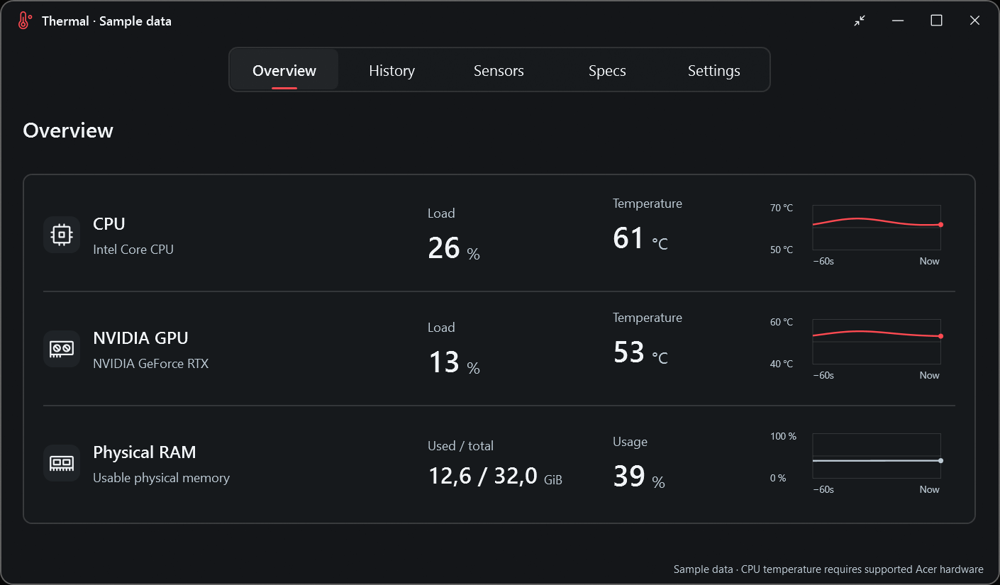

# Thermal

A minimal hardware monitor for **Windows 11 x64**, with a frosted-glass interface, red accents and live charts.

Track CPU load, RAM usage and NVIDIA GPU temperature and load. CPU temperature is optional and currently limited to a specific Acer laptop configuration; it is not available on every Windows PC.



*Sample data. CPU temperature requires a supported Acer configuration.*

## What it shows

| Reading | Availability |
| --- | --- |
| CPU load | Windows; up to 64 logical processors |
| Physical RAM usage | Windows |
| GPU temperature and load | Supported NVIDIA GPUs through the installed NVIDIA driver |
| CPU temperature | Optional; supported Acer configuration only |
| PC specifications | Hardware information detected from Windows |

Intel and AMD GPU readings are not implemented. Unavailable sensors are shown as unavailable.

## Features

- Live readings with an adjustable sampling interval.
- Temperature and load charts with one or four hours of in-memory history.
- Compact mode, an always-on-top option and a system tray menu.
- A separate PC specifications page.
- CSV export and optional local logging, off by default.

Glass effects depend on Windows and accessibility settings. An opaque fallback is available.

## Optional Acer CPU temperature

CPU temperature support is currently limited to the **Acer Predator PHN16-72 with BIOS V1.11**. Other Acer models and general Intel/AMD CPU temperature readings are not supported yet. Windows updates may disable these readings if the compatibility checks no longer pass.

Access is **off by default**. Enable it in Settings for the current session. Windows then asks for administrator permission for a separate, read-only PowerShell reader; the main app stays unelevated. Declining leaves ordinary monitoring available.

Thermal installs no driver or service. The reader stops when Thermal closes, and sessions last up to four hours.

## Privacy and local data

Thermal has no telemetry, cloud upload, automatic network updater or network listener.

Chart history stays in memory. Optional logging writes CSV files to `%LOCALAPPDATA%/Thermal/Logs`, limited to seven days, ten files and 100 MiB. CSV export also works when logging is disabled. Exported files include device names and readings, so review them before sharing.

## Build from source

You need **Windows 11 x64**, **PowerShell 7** and the Microsoft .NET SDK version specified in [global.json](global.json). Install those separately, then run from the repository root:

```powershell
./scripts/build-public.ps1 -Test
dotnet run --project src/Thermal.App -c Release --no-restore
```

The build uses no external NuGet or JavaScript packages. NVIDIA readings use your installed driver; no NVIDIA driver or SDK is bundled.

## Preview status

Thermal is an early preview for Windows 11 x64. Windows 10 and ARM64 are not currently supported. Broader hardware coverage, sleep/resume and extended use still need more testing.

Preview binaries are unsigned and may show a Windows publisher or reputation warning. Use trusted release checksums or build from source.

## Licence and contributing

Original code is available under the [MIT licence](LICENSE). Adapted Phosphor Icons 2.1.10 are also MIT; see the [full icon notice](THIRD-PARTY-NOTICES/Phosphor-MIT.txt). Windows, .NET and installed GPU/firmware drivers have their own terms.

See [CONTRIBUTING.md](CONTRIBUTING.md) for development guidance and [SECURITY.md](SECURITY.md) for security reporting.
